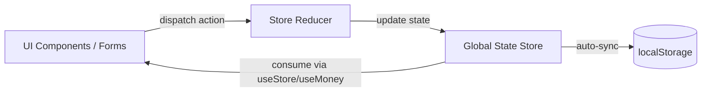

# BankDash — Modern Financial & Banking Dashboard

A modern, high-performance financial dashboard built with **React 18**, **Vite 5**, **Tailwind CSS v4**, and **Recharts**. The design is inspired by the Figma BankDash UI Kit, elevated with a bespoke **Modern Emerald & Warm Amber Gold** color theme, responsive layouts, centralized state management, and real-time interactive workflows.

---

## 📑 Table of Contents

- [Overview](#-overview)
- [Key Features](#-key-features)
- [Design System & Theme Tokens](#-design-system--theme-tokens)
- [Pages & Modules Guide](#-pages--modules-guide)
- [Architecture & Directory Structure](#-architecture--directory-structure)
- [Tech Stack & Dependencies](#-tech-stack--dependencies)
- [State Management & Data Flow](#-state-management--data-flow)
- [Getting Started](#-getting-started)
- [Build & Deployment](#-build--deployment)
- [Responsiveness & Accessibility](#-responsiveness--accessibility)
- [License & Credits](#-license--credits)

---

## 🌟 Overview

**BankDash** is a production-grade single-page application (SPA) created to manage credit cards, transactions, loans, investments, services, and profile preferences in an intuitive, fintech-grade interface.

Rather than relying on generic styling or the default Figma royal blue palette (`#2D60FF`), this application applies a **Modern Emerald & Warm Amber Gold** visual identity. The palette is applied across navigation, credit cards, badges, buttons, charts, and dark mode surfaces to deliver a polished experience.

---

## ⚡ Key Features

- **9 Fully Implemented Pages:** Seamless client-side hash routing (`#dashboard`, `#transactions`, `#accounts`, `#investments`, `#cards`, `#loans`, `#services`, `#privileges`, `#settings`) without page reloads.
- **Custom Emerald & Warm Amber Palette:** Departure from the standard Figma blue with an executive, modern fintech color scheme.
- **Synchronized Light & Dark Theme:** System-aware or manual one-click theme switcher with persistent storage and theme-aware SVG charts.
- **Interactive Recharts Visualizations:** Responsive Bar, Line, Area, Donut, and Pie charts that dynamically adapt colors, tooltips, and grid lines to the active theme.
- **Persistent Centralized State:** Unified React Context store with reducer actions and automatic `localStorage` synchronization.
- **Dynamic Multi-Currency Engine:** Live currency converter toggle supporting **USD ($)**, **EUR (€)**, **GBP (£)**, and **INR (₹)** that instantly reformats financial metrics across all 9 pages.
- **Real-Time Interactive Workflows:**
  - **Quick Transfer:** Instant money transfer with contact carousel, amount input, live balance deduction, and toast notifications.
  - **Card Management:** Add new card with auto-formatting, validation, block/unblock toggles, change PIN modal, and card details view.
  - **Loan Repayment & Application:** Loan product catalog, monthly installment calculations, and instant repayment deductions.
  - **Investment Portfolio:** Add new investments, track returns, and view trending stocks.
  - **Rewards & Privileges:** Real-time points balance, membership tier progress bar, and rewards redemption catalog.
  - **Transaction Filtering:** Global real-time search, category tab filters (All/Income/Expense), pagination, and printable receipt modals.
  - **Profile Management:** Profile details editor with avatar file upload/preview, password update, and 2FA toggles.
- **Fully Responsive Layout:** Optimized for Desktop (`≥ 1280px`), Tablet (`768px – 1279px`), and Mobile (`< 768px`) with slide-over drawer navigation and touch-friendly hit targets.

---

## 🎨 Design System & Theme Tokens

The design system bridges CSS variables via the **Tailwind CSS v4 `@theme` directive** and JavaScript chart configurations via `src/theme.js`.

### Color Palette

| Token | Light Mode | Dark Mode | Usage |
| :--- | :--- | :--- | :--- |
| `--primary` | `#0F766E` (Emerald) | `#2DD4BF` (Mint) | Primary brand, active states, main buttons, deposit charts |
| `--primary-dark` | `#0D5F59` | `#14B8A6` | Button hover states, active borders |
| `--primary-soft` | `#E6F4F1` | `rgba(45, 212, 191, 0.14)` | Subtitle badges, active navigation pills, hover states |
| `--accent` | `#F59E0B` (Amber) | `#FBBF24` (Amber Gold) | Highlights, card chips, credit charts, reward points |
| `--accent-soft` | `#FEF3C7` | `rgba(251, 191, 36, 0.16)` | Amber badge backgrounds, warning cards |
| `--surface` | `#FFFFFF` | `#111C24` | Card panels, modals, dropdown menus |
| `--surface-2` | `#F8FAFC` | `#17242E` | Table headers, secondary containers, input fields |
| `--bg` | `#F5F7FA` | `#0B1319` | Application canvas background |
| `--ink` | `#1A2530` | `#F8FAFC` | High-emphasis headings, title typography |
| `--text` | `#2D3E50` | `#CBD5E1` | Body copy, table content, labels |
| `--muted` | `#6B7C93` | `#889CAE` | Secondary captions, dates, inactive icons |
| `--line` | `#E5EBF0` | `#1E2F3C` | Card borders, dividers, subtle outlines |
| `--pos` | `#10B981` | `#34D399` | Positive income, active status pills |
| `--neg` | `#EF4444` | `#F87171` | Negative expense, blocked badges, errors |

### Typography & Radii

- **Font Family:** `Inter`, system-ui, -apple-system, sans-serif
- **Card Radius:** `rounded-[24px]` (`--radius-card`)
- **Button / Control Radius:** `rounded-xl` (`--radius-sm`) / `rounded-full` (pills)

---

## 🧭 Pages & Modules Guide

```
#dashboard ─── #transactions ─── #accounts ─── #investments ─── #cards ─── #loans ─── #services ─── #privileges ─── #settings
```

### 1. Dashboard (`#dashboard`)
The command center of BankDash:
- **My Cards:** Live view of the top two credit cards with balance, cardholder, expiry, and masked numbers.
- **Recent Transactions:** The last 3 financial activities with categorized tone badges and positive/negative indicators.
- **Weekly Activity Chart:** Dual-bar visualization comparing weekly deposits (Emerald) and withdrawals (Navy/Slate).
- **Expense Statistics Chart:** Polar pie chart categorizing expenditures into Entertainment, Bill Expense, Investment, and Others.
- **Quick Transfer:** Interactive contact carousel with role badges, amount input, and instant transfer execution.
- **Balance History Chart:** Smooth spline area chart mapping monthly balance growth with an emerald gradient fill.

### 2. Transactions (`#transactions`)
Full transaction registry and accounting tools:
- **Cards Overview:** Side-by-side card tiles.
- **My Expense Bar Chart:** Interactive monthly spend chart highlighting the active hovered month with real-time value callouts.
- **Tab Filters:** Filter transactions by `All Transactions`, `Income`, or `Expense`.
- **Global Search:** Case-insensitive search filtering across description, transaction ID, and transaction type.
- **Transaction Table:** Complete ledger showing status icons, description, ID, card reference, date, and amount.
- **Receipt Downloader:** Modal receipt viewer displaying complete transaction details and completed status.
- **Pagination:** Responsive pagination controls with previous/next navigation.

### 3. Accounts (`#accounts`)
Executive balance summary and weekly cashflow:
- **Summary Tiles:** 4 metric cards for `My Balance`, `Income`, `Expense`, and `Total Saving`.
- **Last Transaction:** Quick list of recent activities with card references.
- **My Card:** Display of the primary active card.
- **Debit & Credit Overview:** Grouped bar chart comparing weekly debited vs. credited funds.
- **Invoices Sent:** Invoice feed with vendor badges and time-ago indicators.

### 4. Investments (`#investments`)
Portfolio tracking and asset management:
- **Metrics Tiles:** `Total Invested Amount`, `Number of Investments`, and `Rate of Return`.
- **Yearly Total Investment:** Stepped line chart with data points showing yearly growth.
- **Monthly Revenue:** Smooth spline line chart tracking revenue trends.
- **My Investment List:** Asset list with investment values, percentage return badges, and a `+ New Investment` modal with full validation.
- **Trending Stocks Table:** Live stock monitoring with ticker names, share prices, and return percentages.

### 5. Credit Cards (`#cards`)
Comprehensive credit card lifecycle management:
- **Cards Carousel:** Interactive grid displaying all cards with active selection rings.
- **Card Expense Statistics:** Donut chart showing spending distribution across issuing banks.
- **Card List:** Table of active cards with masked numbers and a `View Details` modal offering card deletion and freeze toggles.
- **Add New Card Form:** Card issuance form with live 16-digit card number spacing, MM/YY expiration formatting, bank selector, and validation.
- **Card Settings:** Quick action buttons for `Block/Unblock Card`, `Change PIN Code` (with 4-digit validation modal), `Google Pay`, and `Apple Pay`.

### 6. Loans (`#loans`)
Borrowing facilities and repayment tracking:
- **Loan Products:** 4 loan categories (`Personal`, `Corporate`, `Business`, `Custom`) that trigger an interactive `Apply Loan` modal with duration selectors and automated installment calculations.
- **Active Loans Overview:** Detailed table with loan principal, remaining balance, duration, interest rate, monthly installment, and repayment status.
- **Loan Repay Workflow:** Repayment modal supporting custom payments or single-click `Pay full amount`.
- **Summary Footer:** Dynamic totals summing total debt, remaining balance, and total monthly obligations.

### 7. Services (`#services`)
Banking products and financial concierge:
- **Featured Services:** Highlighted tiles for `Life Insurance`, `Shopping`, and `Safety`.
- **Services Catalog:** Detailed service listings with multi-column benefit previews.
- **Service Details Modal:** Modal breaking down coverage, terms, and a `Request this service` action.

### 8. My Privileges (`#privileges`)
Customer loyalty and rewards program:
- **Tier Membership Card:** Gradient membership card displaying status tier (`Silver`, `Gold`, `Platinum`), available points, and an animated progress bar to the next tier.
- **Earning Guide:** Breakdown of points accrual rules.
- **Rewards Catalog:** Redeemable rewards with points cost and balance validation (disables actions if points are insufficient).
- **Redemption History:** Ledger tracking redeemed rewards, dates, and deducted points.

### 9. Settings (`#settings`)
User preferences and account security:
- **Edit Profile:** Personal details editor with avatar photo upload/removal, email validation, postal code formatting, and address fields.
- **Preferences:** Live theme toggle (Light/Dark), live Currency switcher (`USD`, `EUR`, `GBP`, `INR`), timezone picker, and notification checkboxes.
- **Security:** Two-factor authentication (2FA) toggle and password change form with length validation.
- **Reset Demo Data:** One-click reset returning demo state to default initial seeds.

---

## 📂 Architecture & Directory Structure

```
Bank Dashboard/
├── dist/                     # Optimized production bundle (created on build)
├── public/                   # Static assets
│   ├── avatars/              # Profile & contact avatar images
│   │   ├── anna.jpg
│   │   ├── livia.jpg
│   │   ├── omar.jpg
│   │   ├── randy.jpg
│   │   └── workman.jpg
│   ├── bankdash-logo.jpg     # BankDash branding icon
│   └── profile.jpg           # Default user profile photo
├── src/
│   ├── components/
│   │   ├── Layout.jsx        # Sidebar, Header, Notifications, Search
│   │   └── ui.jsx            # Reusable UI primitives (Panel, Section, StatTile, CreditCard, Modal, Tabs, etc.)
│   ├── pages/                # Individual page views
│   │   ├── Accounts.jsx
│   │   ├── CreditCards.jsx
│   │   ├── Dashboard.jsx
│   │   ├── Investments.jsx
│   │   ├── Loans.jsx
│   │   ├── Privileges.jsx
│   │   ├── Services.jsx
│   │   ├── Settings.jsx
│   │   └── Transactions.jsx
│   ├── App.jsx               # Application root & hash routing controller
│   ├── Icons.jsx             # Zero-dependency SVG icon system (24x24)
│   ├── data.js               # Initial seed data for cards, loans, stocks, etc.
│   ├── main.jsx              # React DOM entry point
│   ├── store.jsx             # React Context provider, useReducer store, & formatters
│   ├── styles.css            # Tailwind CSS v4 entry point & CSS theme variables
│   ├── theme.js              # Theme color constants for Recharts and icon badges
│   ├── useBreakpoint.js      # Responsive viewport detection hook
│   ├── useChartTheme.js      # Recharts theme-aware synchronization hook
│   └── utils.js              # Utility helpers (initials, navigation, txStyle)
├── index.html                # HTML5 entry point with preloader & font links
├── package.json              # Project scripts and dependencies
└── vite.config.js            # Vite 5 configuration with Tailwind CSS plugin
```

---

## 💻 Tech Stack & Dependencies

| Category | Technology | Version | Purpose |
| :--- | :--- | :--- | :--- |
| **Framework** | React | `^18.3.1` | Component architecture, state management, hooks |
| **Runtime** | ReactDOM | `^18.3.1` | Browser DOM rendering |
| **Build Tool** | Vite | `^5.4.0` | Dev server, HMR, and Rollup bundling |
| **Styling** | Tailwind CSS | `^4.3.3` | Utility-first styling via `@tailwindcss/vite` |
| **Charts** | Recharts | `^2.12.7` | SVG-based responsive data visualizations |
| **Single-file Plugin** | vite-plugin-singlefile | `^2.0.2` | Optional single-file HTML compilation |
| **Icons** | Custom SVGs | Native | Zero-dependency, lightweight stroke icons |

---

## 🔄 State Management & Data Flow

BankDash uses a centralized React Context store (`src/store.jsx`) with a clean reducer pattern.



### Supported Actions:
- `sendMoney`: Deducts card balance, prepends transaction, and adds notification.
- `addCard`: Appends a new credit card to the portfolio.
- `toggleBlock`: Freezes or unfreezes a card.
- `removeCard`: Removes a card from the account.
- `repayLoan`: Deducts loan balance, logs repayment transaction, and notifies user.
- `applyLoan`: Approves a new loan and adds it to the active loans ledger.
- `addInvestment`: Adds an investment asset to the portfolio.
- `redeem`: Deducts loyalty points and logs rewards history.
- `updateProfile`: Updates user profile information and custom avatar.
- `updatePrefs`: Updates currency, timezone, and notification settings.
- `readAll`: Marks all notifications as read.
- `reset`: Restores all data to the initial factory seed state.

---

## 🛠️ Getting Started

### Prerequisites
- **Node.js**: v18.0.0 or later (Node v20+ / v22+ recommended)
- **npm**: v9.0.0 or later

### Installation

```bash
# 1. Clone or navigate to the repository
cd "Bank Dashboard"

# 2. Install dependencies
npm install

# 3. Start the local development server
npm run dev
```

The application will be accessible at:
- **Local:** `http://localhost:5173/`
- **Network:** `http://<your-local-ip>:5173/`

---

## 🚀 Build & Deployment

### Production Build

```bash
# Build multi-file production bundle
npm run build

# Preview production build locally
npm run preview
```

The compiled assets are generated in the `dist/` directory:
- Optimized JavaScript chunks with tree-shaking
- Minified CSS via Tailwind CSS v4
- Compressed HTML entry point

### Self-Contained Single-File Build (Optional)

To bundle the entire dashboard into a single, portable HTML file (embeds all JS, CSS, and SVG inline):

```bash
npm run build -- --env SINGLE=1
```

### Deployment Targets

- **Vercel:** Connect the repository. Framework preset: `Vite`, Build command: `npm run build`, Output directory: `dist`.
- **Netlify:** Build command: `npm run build`, Publish directory: `dist`.
- **GitHub Pages:** Deploy the `dist/` folder using `gh-pages` or a GitHub Actions workflow.

---

## 📱 Responsiveness & Accessibility

- **Desktop (≥ 1280px):** Permanent 250px sidebar, full multi-column dashboard grid, expansive charts.
- **Tablet (768px – 1279px):** Adaptive 2-column layouts, touch-friendly tables, and optimized chart aspect ratios.
- **Mobile (< 768px):** Slide-over hamburger drawer with backdrop blur, expandable mobile search, stacked card layouts, and horizontally scrollable data tables.
- **Accessibility:**
  - Accessible ARIA labels on all icon buttons (`aria-label`).
  - Semantic HTML landmarks (`<header>`, `<main>`, `<aside>`, `<nav>`, `<section>`).
  - High-contrast text ratios conforming to WCAG AA guidelines in both light and dark modes.
  - Keyboard navigation support (`Escape` key closes modals).

---

## 📜 Credits & License

- **Design Inspiration:** Based on the Figma BankDash UI Kit, redesigned with custom Emerald & Amber theme styling and interactions.
- **License:** MIT License — free for personal and commercial use.
